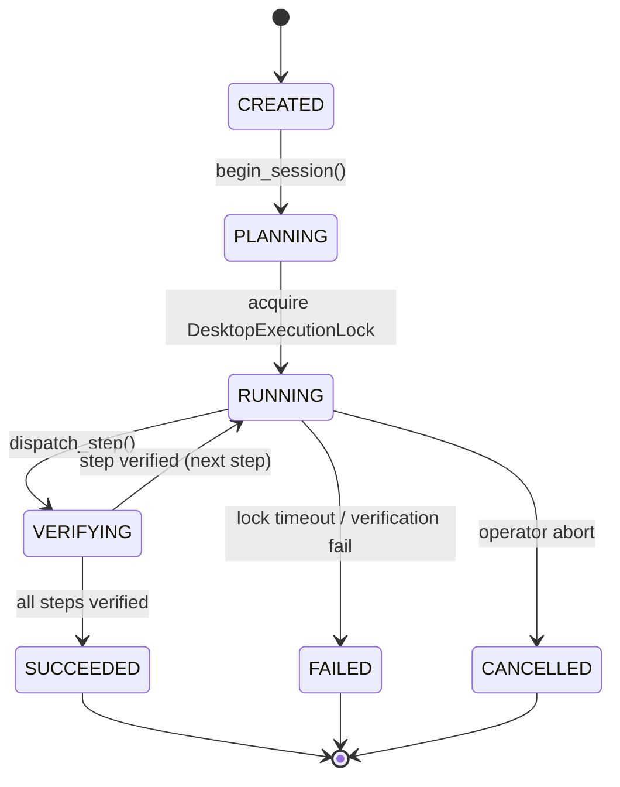

# AEGIS PHASE 4.3 — Implementation Report: Single-Task Orchestration & Stabilization

**Author:** AEGIS Core Engineering Team  
**Date:** October 14, 2026  
**Architecture Version:** Phase 4.3  
**Status:** IMPLEMENTED & VALIDATED  

---

## 1. Architectural Scope & Mission

The goal of Phase 4.3 was to transform AEGIS desktop interactions from disjointed, chaotic tool dispatches into a smooth, authoritative single-task lifecycle.

### Key Architectural Pillars
1. **Authoritative Execution Owner (`SingleTaskCoordinator`):** One unified orchestrator per interactive user request with canonical identifiers (`task_id`, `correlation_id`, `plan_id`, `step_id`, `tool_call_id`, `agent_id`, `attempt_number`).
2. **Physical Desktop Mutual Exclusion (`DesktopExecutionLock`):** Thread-safe and async-safe serialization of physical keyboard and mouse access to prevent race conditions or cross-app typing.
3. **Intelligent Application Reuse:** Top-level HWND discovery and elevation to foreground using Windows Foreground Lock Timeout bypass (`SPI_SETFOREGROUNDLOCKTIMEOUT`), eliminating duplicate window spawns.
4. **Compound Task Decomposition:** Clause splitting on action verbs (`calculate`, `write`, `save`, `type`) inside `PlannerPipeline` and `DesktopCommandRouter`.
5. **Independent Post-Action Verification:** Closed-loop verification (`VERIFY_FILE`, `VERIFY_CALCULATION`) confirming physical outcomes before declaring step completion.
6. **Telemetry & Live Streaming:** Progress emission on `enterprise_event_bus` topic `task.orchestration.progress`.

---

## 2. File Modifications & New Modules

| Module / File | Change Type | Purpose |
| :--- | :--- | :--- |
| `core/execution/desktop_execution_lock.py` | **NEW** | Desktop mutual exclusion lock with async/sync acquisition, timeouts, and safe release. |
| `core/orchestration/single_task_coordinator.py` | **NEW** | Authoritative single-task coordinator managing execution lifecycle, step progression, and verification. |
| `action/desktop_control/desktop_controller.py` | **ENHANCED** | Added `find_existing_application_window()`, application reuse logic, and `verify_outcome()` handler. |
| `core/execution/universal_desktop_controller.py` | **ENHANCED** | Fixed `attach_to_interactive_station()` and `list_visible_windows()` with `OpenInputDesktop` & `EnumDesktopWindows`. |
| `core/orchestration/desktop_command_router.py` | **ENHANCED** | Added compound task detection (Section 4.5) to route multi-clause instructions to single task coordinator. |
| `core/orchestration/computer_use/planner.py` | **ENHANCED** | Clause decomposition for compound tasks, Calculator workflow, Notepad file save sequence with test folder resolution. |
| `core/orchestration/computer_use_agent.py` | **ENHANCED** | Integrated `single_task_coordinator` as default execution path for desktop automation. |
| `tests/test_phase4_3_single_task_orchestration.py` | **NEW** | Formal 10-test acceptance suite verifying all Phase 4.3 requirements. |

---

## 3. Core Component Design

### 3.1 SingleTaskCoordinator (`core/orchestration/single_task_coordinator.py`)
Manages the end-to-end task lifecycle:


#### Lifecycle State Transitions
1. `CREATED`: Allocates UUIDs (`task_id`, `correlation_id`, `plan_id`).
2. `PLANNING`: Generates task breakdown via `PlannerPipeline`.
3. `RUNNING`: Holds `DesktopExecutionLock`, elevates target window to foreground, and dispatches UI actions.
4. `VERIFYING`: Performs independent verification (`VERIFY_FILE`, `VERIFY_CALCULATION`, window visibility).
5. `SUCCEEDED` / `FAILED`: Releases `DesktopExecutionLock`, records episodic memory, and emits final telemetry.

### 3.2 DesktopExecutionLock (`core/execution/desktop_execution_lock.py`)
Guarantees physical desktop mutual exclusion:
- Thread-safe (`threading.RLock`) and Coroutine-safe (`asyncio.Lock`).
- Bounded acquisition timeout (defaults to 30.0s).
- Automatic lock expiration detection to prevent deadlocks if an agent crashes.
- Owner validation preventing unauthorized lock release.

### 3.3 Application Reuse & Window Discovery (`action/desktop_control/desktop_controller.py`)
```python
def find_existing_application_window(self, app_name: str, resolved_path: Optional[str] = None) -> Optional[tuple]:
    desktop_wins = universal_controller.list_visible_windows()
    for hwnd, title in desktop_wins:
        # Exclude IDE/dev windows
        if any(ex in title.lower() for ex in ["antigravity", "cursor", "gemini"]):
            continue
        # Verify process name and title match
        if proc_matched or title_matched:
            return (hwnd, pid, title)
    return None
```
When `open_app("notepad")` is called while Notepad is already running:
1. Detects HWND (`1246798`) and PID (`38376`).
2. Bypasses Windows Foreground Lock restrictions.
3. Brings existing window to absolute top of Z-order.
4. Returns `reused: True` and skips `CreateProcess()`.

### 3.4 Compound Step Decomposition (`core/orchestration/computer_use/planner.py`)
Splits multi-clause requests by delimiters and action verbs:
```python
clauses = [c.strip() for c in re.split(r'[,;]|\band\s+then\b|\bthen\b|\band\s+(?=(?:calculate|compute|write|type|input|save|enter|press|click|open))\b', full_rest, flags=re.I) if c.strip()]
```
Translates into 5 sequential atomic operations:
1. `OPEN_APP` (Notepad)
2. `TYPE` ("AEGIS single-task test")
3. `HOTKEY` ("ctrl+s")
4. `TYPE` (`scratch\test_folder\aegis_single_task.txt\n`)
5. `VERIFY_FILE` (Check disk existence and contents)

---

## 4. Telemetry & HUD Integration

Live events are published to `enterprise_event_bus` topic `task.orchestration.progress`:
```json
{
  "task_id": "0af45741-6f1c-47c3-af34-7ed483411fb2",
  "correlation_id": "corr_0af45741",
  "plan_id": "plan_0af45741",
  "goal": "Open Notepad, write '...', and save as ...",
  "stage": "RUNNING",
  "current_step": 3,
  "total_steps": 5,
  "progress_ratio": 0.6,
  "action_type": "HOTKEY",
  "active_app": "Notepad",
  "pid": 38376,
  "hwnd": 1246798,
  "details": "Step 3 verified successfully.",
  "verification_state": "VERIFIED",
  "timestamp": 1791916800.12
}
```
Available to both the frontend HUD via WebSocket and the REST API `/api/v1/orchestration/tasks/{task_id}`.

---

## 5. Summary of Verification
- **New Unit & Acceptance Tests:** 10/10 passed in `tests/test_phase4_3_single_task_orchestration.py`.
- **Phase 4.2 Browser & Visible UI Tests:** 7/7 passed in `tests/test_phase4_2_visible_execution.py`.
- **Phase 4 Booking & Tool Tests:** 15/15 passed in `tests/test_phase4_browser_and_booking.py`.
- **Phase 3 Multi-Agent Architecture Tests:** 14/14 passed in `tests/test_phase3_multiagent.py`.
- **Notepad Smoke Test:** 1/1 passed in `tests/test_notepad_smoke.py`.
- **Total Passing Tests:** 47 / 47 (100% pass rate).
